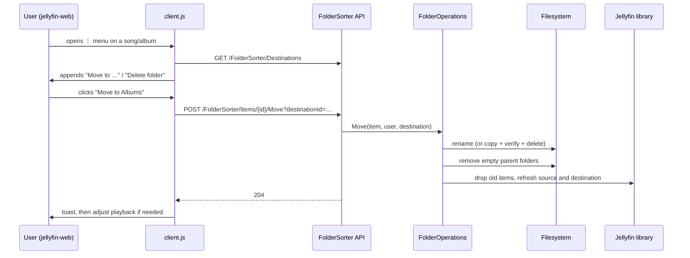

# Jellyfin Folder Sorter

A Jellyfin plugin for sorting a music collection while you listen to it. You can move a song's or album's
whole folder to another library, or delete the folder, straight from Jellyfin's normal item menu. It's
modelled on foobar2000's "File Operations" workflow:

1. Put new releases in an "unchecked" library.
2. Play them.
3. From the **⋮** menu, pick **Move to Albums**, **Move to Singles** (or any destination you configure) or
   **Delete folder**.

The folder moves on disk, empty parent folders are cleaned up, and both libraries update within seconds.
Nothing inside the folder is renamed or changed.

Target: **Jellyfin 12.2** (server and the bundled web client). No fork of jellyfin-web is needed.

## Features

- **Move to &lt;destination&gt;** in the menus of songs and albums:
  - album details page;
  - song rows and album/song cards (the ⋮ button, or right-click);
  - the now-playing bar and Now Playing page.
- **Delete folder**, with a confirmation that shows the folder name.
- **Moves whole releases.** A song moves the album folder Jellyfin assigned it to, so multi-disc releases
  (`Album/Disc 1`, `Album/Disc 2`) move as one. Songs that aren't in an album folder move their own
  directory.
- **Keeps names exactly.** The folder and everything in it keep their names, bytes and structure:
  spaces, brackets, non-ASCII characters, hidden files and empty subfolders are all preserved.
- **Never overwrites.** If the destination already has a folder with the same name, the move is refused.
- **Cleans up empty parents.** Folders left empty in the source library (for example `Artist/` after its
  only album was moved) are removed. The library root itself is never removed.
- **Moves across filesystems.** If the destination is on another filesystem, the folder is copied,
  checked (file count and total size) and only then removed from the source.
- **Updates the library immediately.** You don't have to wait for a scan or the realtime monitor. Play
  counts and favourites survive the move.
- **Handles playback.** If you move or delete the folder you're listening to, the web player continues
  with the next queued track outside that folder, or stops if there is none.
- **Admin page** for managing destinations.

## How it works

The plugin has two parts:

- **Server side:** an HTTP API, the destination settings and the actual filesystem operations.
- **Client side:** a small script that adds the menu entries to the web client.

Jellyfin has no built-in way for a plugin to add JavaScript to the web client. The third-party
[File Transformation](https://github.com/IAmParadox27/jellyfin-plugin-file-transformation) plugin fills
that gap: it adds a `<script>` tag for `/FolderSorter/client.js` to `index.html` as the file is served.



## Requirements

| Component | Version | Notes |
|---|---|---|
| Jellyfin server | 12.2 | Built against the `Jellyfin.Controller`/`Jellyfin.Model` 12.2.0 packages. Other 12.x releases are untested. 13.x is not supported. |
| File Transformation plugin | 3.0.3.0 (12.2 build) | Needed for the menu entries. Without it, the API and admin page still work. |
| .NET SDK | 10.0 | Only on the machine you build on. The server needs only the runtime it already has. |
| Server OS | Linux recommended | See [Open files](#open-files-and-platform-notes). |

The menu entries only appear in clients that load the Jellyfin web client (`index.html`): browsers and
apps that wrap the web client. Native clients such as Finamp, Swiftfin, Findroid and Android TV don't
show them.

## Installation

### 1. Install File Transformation

1. In Jellyfin, open **Dashboard → Plugins → Repositories** and add:

   ```
   https://www.iamparadox.dev/jellyfin/plugins/manifest.json
   ```

2. Install **File Transformation** from the catalogue and restart the server.

### 2. Build Folder Sorter

You can build on any OS. The output is platform-neutral .NET and only contains the plugin's own files
(`Jellyfin.Plugin.FolderSorter.dll`, `.deps.json`, `.pdb`). Jellyfin's assemblies are deliberately left
out.

```sh
cd Jellyfin.Plugin.FolderSorter
dotnet publish -c Release -o ../publish/FolderSorter_1.0.0.0
```

### 3. Copy it to the server

Put the folder in the server's `plugins` directory, next to `FileTransformation_*`. The location depends
on how Jellyfin is installed:

- **Debian/Ubuntu package:** usually `/var/lib/jellyfin/plugins`.
- **Docker:** a `plugins` folder under the mounted `/config`; the exact path depends on the image.
- **Not sure:** the startup log line `Loaded assembly Jellyfin.Plugin.FileTransformation … from …`
  shows the path.

```sh
scp -r ../publish/FolderSorter_1.0.0.0 you@server:/tmp/
ssh you@server
sudo mv /tmp/FolderSorter_1.0.0.0 /var/lib/jellyfin/plugins/
sudo chown -R jellyfin:jellyfin /var/lib/jellyfin/plugins/FolderSorter_1.0.0.0
sudo systemctl restart jellyfin
```

- **Folder name:** it must be `FolderSorter_<version>`. Jellyfin finds plugins by folder name, and no
  manifest is needed.
- **Permissions:** the `jellyfin` user must be able to write to the folder, because the server writes a
  `meta.json` into it on first load.

### 4. Check that it loaded

The server log should contain:

```
Loaded plugin: Folder Sorter 1.0.0.0
Registered the Folder Sorter index.html transformation with File Transformation.
```

You can also check from a shell:

```sh
curl -s http://server:8096/web/index.html | grep -c FolderSorter/client.js   # → 1
```

If the second log line is replaced by `File Transformation plugin not found; Folder Sorter menu entries are
disabled`, File Transformation isn't installed or didn't load.

After installing, reload the browser tab. A hard refresh may be needed if the old `index.html` is cached.

### Updating and uninstalling

- **Update:** replace the contents of `FolderSorter_1.0.0.0`, or use a new version folder and delete the
  old one. Then restart. Don't leave two versions side by side.
- **Uninstall:** delete the folder, or use **Dashboard → Plugins**, then restart.

Destinations are stored separately in `plugins/configurations/Jellyfin.Plugin.FolderSorter.xml`, so
updating or reinstalling keeps them.

## Configuration

Open **Dashboard → Folder Sorter** (in the sidebar). Each destination has:

| Field | Meaning |
|---|---|
| Name | Shown in the menu as "Move to *Name*". |
| Library | The Jellyfin library the destination belongs to. |
| Folder path on server | Absolute path of an **existing** folder. It can be the library's media path itself or any folder inside it. It is never created automatically. **Browse…** opens Jellyfin's server folder picker, starting at the current path or, if that's empty, at the selected library's first media folder. |

Example for a flat `Artist - Title` layout with one library per stage:

| Name | Library | Path |
|---|---|---|
| Albums | Albums | `/music/Albums` |
| Singles | Singles | `/music/Singles` |

The paths are only visible to administrators. Other users only get the destination names.

## Usage

Open the ⋮ menu (or right-click) on a song or album and choose an entry.

### Which folder is affected

| Item | Folder |
|---|---|
| Album | The album's folder. |
| Song inside an album folder | The album folder. For multi-disc releases that's the release folder, not `Disc 2`. |
| Song not inside an album folder | The song's own directory. |

The folder must be **inside** a library media path. A song lying loose in a library root can't be moved,
because that would move the whole library.

### Move

The folder becomes `<destination path>/<folder name>`. The move is refused if:

- a file or folder with that name already exists there;
- the folder is already directly in the destination;
- the destination is inside the folder being moved.

### Delete folder

Removes the album through Jellyfin, as **Delete media** does, and then removes whatever is left in the
folder (covers, `.nfo` files, scans). This is only available for folders Jellyfin sees as an album.

### Permissions

Both actions require the user to be allowed to delete the item: the global **Allow media deletion**
setting or per-library deletion rights. A move takes content out of the source library, so it needs the
same right as a delete. Users without it don't see the entries. Requests authenticated with an API key
are refused, because the plugin needs a user.

### Playback

These rules apply when the current track on **this browser** belongs to the folder being moved or deleted.
After the operation succeeds:

- If there are queued tracks after the current one that are outside the folder, playback restarts on
  those. Earlier, already-played queue entries are dropped.
- If there are none, playback stops.

Playback of other tracks continues untouched, and other devices aren't controlled.

## Behaviour details

### Library refresh

- Jellyfin item IDs are derived from paths, so moved songs and albums get new IDs.
- The plugin removes the old library entries straight away and queues an immediate refresh of the nearest
  existing folder in both the source and the destination library. This is the same mechanism Jellyfin's
  realtime monitor uses.
- If the destination library was empty at its last scan, a library scan is queued instead.
- Changes to the moved paths are hidden from the realtime monitor while the operation runs, so there's no
  duplicate refresh.
- Play counts, favourites and ratings carry over: Jellyfin keys a song's user data on artist, album and
  track name, not on its path.

### Cross-filesystem moves

A rename can't cross filesystems, so in that case the folder is copied:

1. Every entry is copied with its original name, including hidden files and empty directories.
2. Directory modification times are restored.
3. The copy is checked against the source (file count and total bytes).
4. Only then is the source deleted.

If the copy fails or doesn't match, the partial copy is removed and the source stays untouched. If the
copy is good but the source can't be removed, both copies are kept and the error says so.

### Open files and platform notes

- **Linux:** renaming or deleting a folder works even while files in it are open, for example during
  playback or a transcode. Open handles keep reading the old data.
- **Other hosts:** some filesystems refuse to rename or delete open files. The plugin doesn't retry; the
  OS error is shown.

### Error messages

Errors are shown in an alert as plain text:

| Status | Message |
|---|---|
| 400 | `Only songs and albums are supported.` |
| 400 | `Item is not in a subfolder of a library.` |
| 400 | `Already in destination.` |
| 400 | `Destination is inside the folder being moved.` |
| 400 | `Destination folder does not exist.` |
| 400 | `Destination is not inside its library.` |
| 400 | `This song is not inside an album folder.` (delete) |
| 403 | `You do not have permission to remove this item from its library.` |
| 403 | `The Jellyfin server user cannot write to <path>.` |
| 404 | `Item not found.` / `Unknown destination.` / `Destination library no longer exists.` |
| 409 | `A folder named "<name>" already exists in the destination.` |
| 500 | `Cross-volume copy failed; source left untouched.` or the OS error message |

## HTTP API

All endpoints except `client.js` need a logged-in user (an access token, not an API key).

| Method | Path | Result |
|---|---|---|
| `GET` | `/FolderSorter/client.js` | The injected script. Anonymous, `Cache-Control: no-cache`. |
| `GET` | `/FolderSorter/Destinations` | `[{ "Id": guid, "Name": string }]` |
| `GET` | `/FolderSorter/Items/{itemId}/Folder` | `{ "FolderName": string }`: the folder an action would affect. |
| `POST` | `/FolderSorter/Items/{itemId}/Move?destinationId={guid}` | `204` on success. |
| `DELETE` | `/FolderSorter/Items/{itemId}/Folder` | `204` on success. |

Destinations are edited through Jellyfin's standard plugin configuration endpoints
(`/Plugins/b8e5d3a1-6c4f-4b27-9a0e-3f1d7c52e8a4/Configuration`).

## Project structure

```
Jellyfin.Plugin.FolderSorter/
├── Jellyfin.Plugin.FolderSorter.csproj   net10.0; Jellyfin 12.2.0 packages (compile-only)
├── Plugin.cs                             Plugin entry point, id, admin page registration
├── PluginServiceRegistrator.cs           Registers FolderOperations and the File Transformation registrar
├── Configuration/
│   ├── PluginConfiguration.cs            Destination list (Id, Name, LibraryId, Path)
│   └── destinations.html                 Admin page (embedded resource)
├── Api/
│   └── FolderSorterController.cs         HTTP endpoints, user resolution, error mapping
├── Services/
│   ├── FolderOperations.cs               Folder resolution, validation, move/copy/delete, cleanup, refresh
│   ├── FolderSorterException.cs          Error carrying an HTTP status code
│   ├── FileTransformationRegistrar.cs    Hosted service: registers the index.html patch with File Transformation
│   └── IndexHtmlPatcher.cs               Callback that adds the <script> tag before </body>
└── Web/
    └── client.js                         Injected script: menu entries, actions, playback handling (embedded)
```

### Dependencies

| Dependency | Kind | Purpose |
|---|---|---|
| `Jellyfin.Controller` 12.2.0 | NuGet, compile-only | Library, filesystem monitor and plugin APIs. |
| `Jellyfin.Model` 12.2.0 | NuGet, compile-only | Plugin configuration and page types. |
| File Transformation | Runtime plugin | Serves the modified `index.html`. |

Both NuGet packages are referenced with `ExcludeAssets="runtime"`, because the server provides those
assemblies at runtime. Shipping copies of them in the plugin folder would risk loading mismatched
versions.

File Transformation is called through reflection, so there's no compile-time dependency on it. Its JSON
payload type is used for the registration call to avoid type mismatches between the two plugins'
assemblies.

`client.js` is plain ES5-style JavaScript with no build step. It relies on the web client's global
`ApiClient` and on these selectors from jellyfin-web 12.2:

- action-sheet markup: `.actionSheet`, `.actionSheetScroller`, `.actionSheetMenuItem[data-id]`;
- menu buttons: `.btnToggleContextMenu`, `.btnMoreCommands`, `[data-action="menu"]`;
- item elements: `[data-id]`.

## Development

```sh
cd Jellyfin.Plugin.FolderSorter
dotnet build -c Release
```

To test without touching a real server, run a throwaway 12.2 instance from source:

```sh
git -C ../jellyfin worktree add ../jellyfin-v12.2 v12.2
git -C ../jellyfin-web worktree add ../jellyfin-web-v12.2 v12.2
(cd ../jellyfin-web-v12.2 && npm ci && npm run build:production)

mkdir -p /tmp/jf-data/plugins
# unzip File Transformation's 12.2 release into /tmp/jf-data/plugins/FileTransformation_3.0.3.0/
dotnet publish Jellyfin.Plugin.FolderSorter -c Release -o /tmp/jf-data/plugins/FolderSorter_1.0.0.0

cd ../jellyfin-v12.2
dotnet run --project Jellyfin.Server -- --datadir /tmp/jf-data --webdir ../jellyfin-web-v12.2/dist --ffmpeg "$(command -v ffmpeg)"
```

The `../jellyfin` and `../jellyfin-web` paths assume checkouts of the upstream server and web repositories
next to this one. Finish the setup wizard, create a few Music libraries pointing at scratch folders, add
destinations, and use the web UI at `http://localhost:8096`.

## Known limitations

- **Moving something another device is playing:** other devices (or a move made directly through the API)
  keep reporting playback for the old item ID until they move on. Meanwhile the server logs
  `FOREIGN KEY constraint failed` errors about it. This is harmless but noisy.
- **Queue history:** when the current folder is moved, already-played queue entries are dropped from this
  browser's queue.
- **Web client only:** the menu entries depend on jellyfin-web 12.2's markup. A future web client may need
  selector updates in `Web/client.js`; the server side is unaffected.
- **No merging:** a release that already exists in the destination must be resolved by hand.
